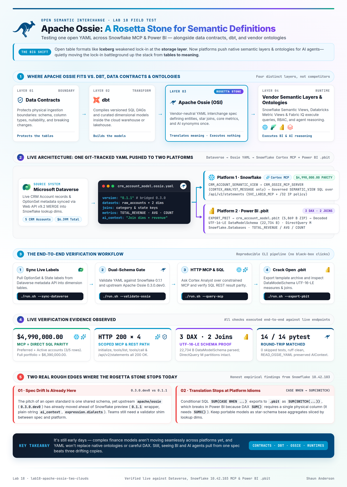
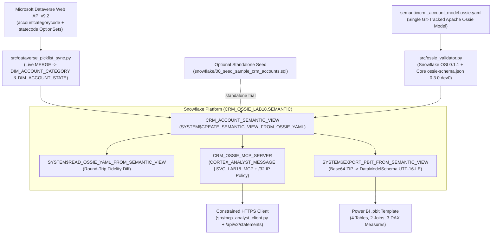

# Lab 18: One Semantic YAML, Multiple Cloud Platforms (Apache Ossie → Snowflake + Power BI)

[](https://ossie.apache.org/)
[](pyproject.toml)
[](https://docs.astral.sh/uv/)
[](https://docs.snowflake.com/en/user-guide/views-semantic/overview)
[](https://learn.microsoft.com/en-us/power-bi/create-reports/desktop-templates)
[](LICENSE)

> **Testing whether one Git-tracked Apache Ossie YAML model works as a practical "Rosetta Stone" across a Snowflake Semantic View (served via constrained HTTPS MCP) and a Power BI `.pbit` template over Microsoft Dataverse CRM accounts — rough edges included.**



*(Interactive HTML source: [`infographic/lab18_ossie_one_pager.html`](infographic/lab18_ossie_one_pager.html) styled in the Apache Ossie light palette.)*

---

## Table of Contents

1. [The "Rosetta Stone" Thesis](#the-rosetta-stone-thesis)
2. [Where Apache Ossie Fits in the Modern Stack](#where-apache-ossie-fits-in-the-modern-stack)
3. [Architecture & Security Boundary](#architecture--security-boundary)
4. [Prerequisites & Trial Setup](#prerequisites--trial-setup)
5. [5-Minute Quickstart](#5-minute-quickstart)
6. [Empirical Findings & Rough Edges](#empirical-findings--rough-edges)
7. [Repository Structure](#repository-structure)
8. [HyperFrames Demo Video & LinkedIn Story](#hyperframes-demo-video--linkedin-story)
9. [Official Documentation & References](#official-documentation--references)
10. [Build Log](#build-log)

---

## The "Rosetta Stone" Thesis

Teams rarely suffer from a shortage of SQL transformations. They suffer from **semantic fragmentation**: the same metric gets redefined separately inside BI workbooks (DAX), warehouse views (SQL), and AI agent system prompts — and quietly drifts apart.

After running this lab end to end over Microsoft Dataverse CRM account records (`RAW_ACCOUNTS`) and dynamically synced Dataverse OptionSets (`DIM_ACCOUNT_CATEGORY`, `DIM_ACCOUNT_STATE`), the role of **Apache Ossie** (formerly *Open Semantic Interchange* / OSI) becomes clear:

- One Git-versioned YAML file ([`semantic/crm_account_model.ossie.yaml`](semantic/crm_account_model.ossie.yaml)) compiles directly into a native **Snowflake Semantic View** (`CRM_OSSIE_LAB18.SEMANTIC.CRM_ACCOUNT_SEMANTIC_VIEW`) via `SYSTEM$CREATE_SEMANTIC_VIEW_FROM_OSSIE_YAML`.
- A constrained **Snowflake-Managed MCP Server** (`CRM_OSSIE_MCP_SERVER`) exposes `CORTEX_ANALYST_MESSAGE` over HTTPS JSON-RPC (`SVC_LAB18_MCP` + `ROLE_LAB18_MCP` + user-scoped `/32` IP network policy). Natural-language queries compile to governed `SEMANTIC_VIEW(...)` SQL and match direct SQL ground truth to the cent (`$4,990,000.00` Preferred Customer + Active across 3 accounts; `$6,390,000.00` total across 5 accounts).
- The same compiled Semantic View exports directly to a **Power BI `.pbit` archive** via `SYSTEM$EXPORT_PBIT_FROM_SEMANTIC_VIEW`, and Python inspects its UTF-16-LE `DataModelSchema` to verify all 4 tables, 3 DAX measures (`TOTAL_REVENUE`, `AVERAGE_REVENUE`, `ACCOUNT_COUNT`), and both star-schema joins survived translation.

---

## Where Apache Ossie Fits in the Modern Stack

Apache Ossie does not replace physical data contracts, dbt, or native warehouse semantic engines — it sits between transformation and consumption as an **open interchange contract**:

| Layer | Examples | What It Owns | Role Relative to Apache Ossie |
| :--- | :--- | :--- | :--- |
| **1. Physical Boundary Contracts** | Data Contract CLI, ODCS, schema contracts | Column types, freshness, nullability, breaking schema changes | Protects raw/bronze physical ingestion before business metrics exist. |
| **2. Transformation Engine** | dbt, SQL pipelines, Snowflake Dynamic Tables | Joins, deduplication, slowly changing state, silver/gold tables | Builds clean dimensional tables (`RAW_ACCOUNTS`, lookup dims) that semantic models query. |
| **3. Open Semantic Interchange** | **Apache Ossie (OSI)** YAML + `ossie-schema.json` | Vendor-neutral definitions of datasets, PKs, relationships, metrics, and `ai_context` | Portable Git-tracked interchange format (**"Rosetta Stone"**) translating meaning across vendors. |
| **4. Vendor Execution & Ontologies** | **Snowflake Semantic Views / Cortex Analyst**, **Power BI `.pbit` / Fabric IQ**, Databricks Metric Views | Runtime query planning, DAX/SQL execution, RBAC, natural-language grounding | Target runtimes where BI tools and AI agents actually execute queries and enforce permissions. |

---

## Architecture & Security Boundary

- **Interactive Showcase Diagram:** Clone the repo and open [`docs/architecture/lab18-ossie.html`](docs/architecture/lab18-ossie.html) locally in any browser (exported from [`docs/architecture/candidate.json`](docs/architecture/candidate.json)).
- **Security Controls & Threat Model:** See [`SECURITY.md`](SECURITY.md) for full details on RSA admin separation, constrained MCP surface (`CORTEX_ANALYST_MESSAGE` only), dynamic `/32` workstation IP policy resolution, and SQL guardrails.



---

## Prerequisites & Trial Setup

| Component | Requirement | Free / Trial Compatibility | Purpose in Lab 18 |
| :--- | :--- | :--- | :--- |
| **Python & `uv`** | Python 3.11+, [`uv`](https://docs.astral.sh/uv/) | Open Source | Creates isolated `.venv` and manages locked Python packages. |
| **Snowflake Account** | Trial or Standard+ with Semantic Views, Cortex Analyst, and Managed MCP enabled | Works with Snowflake 30-day Free Trial | Hosts `CRM_OSSIE_LAB18.SEMANTIC`, compiles Ossie YAML, exports `.pbit`, serves HTTP MCP. |
| **RSA Key-Pair Auth** | Local PKCS#8 `.p8` key + `ALTER USER ... SET RSA_PUBLIC_KEY=...` | Native Snowflake auth | Authenticates admin DDL compilation and PAT provisioning cleanly without passwords. |
| **Microsoft Dataverse + Azure CLI (`az`)** | Optional (required only for live `--sync-picklists`) | Power Apps Developer Plan | Pulls live `accountcategorycode` and `statecode` labels via Dataverse Web API v9.2. |
| **Standalone Seed SQL** | Optional alternative to Dataverse (`snowflake/00_seed_sample_crm_accounts.sql`) | Self-contained in Snowflake | Seeds 5 synthetic CRM accounts (`$6,390,000.00` total / `$4,990,000.00` Preferred+Active) when running Snowflake-only. |
| **Power BI Desktop** | Optional (Windows) | Free Desktop app | Visually opens generated `.pbit` templates; Python inspects `.pbit` ZIP/JSON cross-platform. |

---

## 5-Minute Quickstart

For complete step-by-step instructions (RSA key generation, Dataverse vs. Snowflake-only trial modes, IP allowlisting, and troubleshooting), read [`docs/SETUP_GUIDE.md`](docs/SETUP_GUIDE.md).

```bash
# 1. Initialize Python 3.11 virtual environment via uv
./setup.sh

# 2. Configure local secrets (never committed)
cp .env.example .env && chmod 600 .env
# Edit .env with your SNOWFLAKE_ACCOUNT, SNOWFLAKE_USER, SNOWFLAKE_PRIVATE_KEY_FILE
# Leave SNOWFLAKE_ALLOWED_IP blank to auto-detect your public /32 IP via api.ipify.org
```

### Run Option A — Live Dataverse + Snowflake Full End-to-End Pipeline

```bash
az login
./run.sh --verify
./run.sh --summary
```

### Run Option B — Snowflake-Only Standalone Trial (No Dataverse Required)

Run [`snowflake/00_seed_sample_crm_accounts.sql`](snowflake/00_seed_sample_crm_accounts.sql) (including its commented lookup `MERGE` block) and [`snowflake/01_setup_ossie_database.sql`](snowflake/01_setup_ossie_database.sql) in Snowsight, then execute the Snowflake pipeline locally:

```bash
./run.sh --validate-ossie   # Validate YAML against Snowflake 0.1.1 + official ossie-schema.json (0.3.0.dev0)
./run.sh --compile          # Compile CRM_ACCOUNT_SEMANTIC_VIEW + verify READ_OSSIE_YAML round-trip
./run.sh --export-pbit      # Export Power BI .pbit + inspect UTF-16-LE DataModelSchema JSON
./run.sh --provision-mcp    # Create CRM_OSSIE_MCP_SERVER, ROLE_LAB18_MCP, SVC_LAB18_MCP + 30d PAT
./run.sh --query-mcp        # Call MCP tools/call (Cortex Analyst) + /api/v2/statements + SQL parity check
```

### Sample Two-Platform Output (`./run.sh --summary`)

```text
=============== LAB 18: ONE SEMANTIC YAML, TWO PLATFORMS ===============
Source Spec : semantic/crm_account_model.ossie.yaml (OSI 0.1.1 -> core 0.3.0.dev0)
Model Scope : 3 datasets | 2 relationships | 3 metrics
Dataverse   : 2 category labels + 2 state labels synced live
------------------------------------------------------------------------
PLATFORM 1 | Snowflake Semantic View + Managed HTTP MCP
  View      : CRM_OSSIE_LAB18.SEMANTIC.CRM_ACCOUNT_SEMANTIC_VIEW (round-trip matched=True)
  MCP HTTP  : init=200 list=200 call=200 | /api/v2/statements=200
  Result    : $4,990,000.00 Preferred+Active (3 accts) | Total=$6,390,000.00 (5 accts) | Parity=True
------------------------------------------------------------------------
PLATFORM 2 | Power BI .pbit Archive Export
  Artifact  : crm_account_model.pbit (5890 bytes, base64_zip)
  Model     : 4 DataModelSchema tables | 3 DAX measures ['ACCOUNT_COUNT', 'AVERAGE_REVENUE', 'TOTAL_REVENUE']
  Joins     : 2 relationships ['RAW_ACCOUNTS.ACCOUNTCATEGORYCODE->DIM_ACCOUNT_CATEGORY.CATEGORY_CODE', 'RAW_ACCOUNTS.STATECODE->DIM_ACCOUNT_STATE.STATE_CODE']
========================================================================
```

---

## Empirical Findings & Rough Edges

Live testing surfaced three concrete boundary behaviors that any team evaluating Apache Ossie should understand:

1. **Upstream Spec Drift (`0.3.0.dev0` vs. Snowflake `0.1.1` Preview):**
   - Official upstream [`apache/ossie` `ossie-schema.json`](semantic/osi-schema.json) sits at `0.3.0.dev0`, whereas Snowflake Semantic View compilation currently requires `version: "0.1.1"`.
   - Snowflake wraps the document under `semantic_model: [...]`, deserializes `ai_context` strictly as a plain `string` (rejecting `{instructions, synonyms}` objects), persists model-level `metrics:` rather than dataset-level metrics, and requires `expression.dialects` (`ANSI_SQL` / `SNOWFLAKE`).
   - [`src/ossie_validator.py`](src/ossie_validator.py) validates Snowflake `0.1.1` rules directly **and** normalizes the AST in memory to `0.3.0.dev0` for JSON Schema verification.

2. **DAX `SUM(SWITCH(TRUE(), ...))` Translation vs. Star-Schema Slicing:**
   - Conditional SQL expressions (`SUM(CASE WHEN ... END)`) defined inside a Semantic View metric currently export to `.pbit` DAX as `SUM(SWITCH(TRUE(), ...))` instead of `SUMX(...)`. Power BI rejects `SUM()` over non-column expressions.
   - Keeping base aggregates clean in Ossie (`TOTAL_REVENUE`, `AVERAGE_REVENUE`, `ACCOUNT_COUNT`) and slicing them across normalized Dataverse lookup dimensions (`DIM_ACCOUNT_CATEGORY`, `DIM_ACCOUNT_STATE`) keeps both Cortex Analyst `SEMANTIC_VIEW(...)` SQL and Power BI DirectQuery DAX valid out of the box.

3. **Constrained MCP Tool Surface (`CORTEX_ANALYST_MESSAGE` Only):**
   - Exposing only `CORTEX_ANALYST_MESSAGE` on `CRM_OSSIE_MCP_SERVER` (never `SYSTEM_EXECUTE_SQL`) ensures MCP returns governed `SELECT * FROM SEMANTIC_VIEW(...)` text-to-SQL without granting arbitrary ad-hoc SQL execution inside the MCP server itself.
   - [`src/mcp_analyst_client.py`](src/mcp_analyst_client.py) extracts the SQL block, verifies via `validate_semantic_sql()` that it is strictly a single `SELECT` targeting `CRM_OSSIE_LAB18.SEMANTIC.CRM_ACCOUNT_SEMANTIC_VIEW`, and executes it over `/api/v2/statements` under least-privilege `ROLE_LAB18_MCP`.

---

## Repository Structure

```text
lab18-apache-ossie-two-clouds/
├── .env.example                        # Placeholder configuration template (copy to .env)
├── LICENSE                             # MIT License
├── LINKEDIN_POST.md                    # Standalone technical write-up
├── README.md                           # Architecture overview, quickstart, and empirical notes
├── SECURITY.md                         # Least-privilege MCP, IP allowlist, and key hygiene controls
├── pyproject.toml                      # uv/hatchling dependencies, ruff, and pytest configuration
├── run.sh                              # CLI wrapper (`--verify`, `--summary`, individual steps)
├── setup.sh                            # uv Python 3.11 virtual environment bootstrap
├── docs/
│   ├── SETUP_GUIDE.md                  # Full Dataverse + standalone Snowflake walkthrough
│   └── architecture/
│       ├── candidate.json              # Architecture graph specification
│       └── lab18-ossie.html            # Standalone interactive HTML architecture diagram
├── infographic/
│   ├── assets/                         # Official Apache Ossie logo mark + platform SVGs
│   ├── lab18_ossie_one_pager.html      # Infographic source HTML (Apache Ossie light palette)
│   └── lab18_ossie_one_pager.png       # Rendered 2400x3360 one-pager PNG
├── semantic/
│   ├── crm_account_model.ossie.yaml    # Canonical Git-tracked Apache Ossie semantic model
│   └── osi-schema.json                 # Upstream apache/ossie JSON Schema (0.3.0.dev0)
├── snowflake/
│   ├── 00_seed_sample_crm_accounts.sql # Optional standalone synthetic CRM sample seed
│   ├── 01_setup_ossie_database.sql     # CRM_OSSIE_LAB18.SEMANTIC lookup tables DDL
│   ├── 02_compile_ossie_semantic_view.sql # Semantic view reference SQL statements
│   └── 03_mcp_server_and_service_user.sql # Constrained MCP server, ROLE_LAB18_MCP, SVC_LAB18_MCP
├── src/
│   ├── config.py                       # Pydantic settings + dynamic MCP URL derivation
│   ├── dataverse_picklist_sync.py      # Dataverse Web API v9.2 OptionSet -> Snowflake MERGE
│   ├── main.py                         # Typer CLI orchestrator and sanitized ledger builder
│   ├── mcp_analyst_client.py           # JSON-RPC MCP client, SQL guardrail, REST SQL executor
│   ├── ossie_validator.py              # Dual Snowflake 0.1.1 + Core 0.3.0.dev0 YAML validator
│   ├── pbit_exporter.py                # Power BI .pbit Base64 ZIP + UTF-16-LE inspector
│   └── snowflake_semantic.py           # RSA auth, dynamic CIDR policy resolution, PAT rotation
├── tests/                              # Offline unit test suite (pytest)
└── video/                              # 70-second HyperFrames HTML/GSAP demo compositions
```

---

## HyperFrames Demo Video & LinkedIn Story

- **LinkedIn Post Text:** [`LINKEDIN_POST.md`](LINKEDIN_POST.md) — ready-to-paste companion write-up summarizing the Rosetta Stone architecture and empirical rough edges.
- **HyperFrames Composition (`video/`):** A 70-second silent visual-first walkthrough (`1920x1080 @ 30fps`) authored across 6 HTML sub-compositions under `video/compositions/`. Generated `.mp4` renders and raw UI screenshots are excluded from Git via `.gitignore`; inspect compositions directly or render locally with HyperFrames (`cd video && npm run check`).

<details>
<summary>90-Second Video Storyboard</summary>

| Time | What's On Screen | Narrative Beat |
| :--- | :--- | :--- |
| **0:00–0:15** | 3-way split: Power BI DAX (`BI Workbook`) vs. Warehouse SQL (`SQL View`) vs. Agent Prompt (`System Prompt`) beside CRM accounts | Metrics drift when the same revenue calculation is hand-rewritten separately in BI, SQL, and prompts. |
| **0:15–0:35** | `semantic/crm_account_model.ossie.yaml` (`metrics` + `ai_context`) + dual schema validation pass | Author datasets, relationships, base metrics, and AI guidance once in Git under Apache Ossie. |
| **0:35–0:52** | Snowflake Semantic View compilation + HTTP MCP `CORTEX_ANALYST_MESSAGE` returning governed `$4,990,000.00` SQL | Compile natively into Snowflake and expose constrained natural-language querying behind `/32` IP + PAT auth. |
| **0:52–0:70** | `SYSTEM$EXPORT_PBIT_FROM_SEMANTIC_VIEW` -> Python UTF-16-LE `DataModelSchema` check + `0.3.0.dev0` vs `SWITCH()` rough edges + infographic reveal | Export `.pbit` from the same Semantic View, verify measures/joins survive, and highlight today's spec/DAX edges. |

</details>

---

## Official Documentation & References

- **Apache Ossie (Incubating) Website:** [ossie.apache.org](https://ossie.apache.org/)
- **Apache Ossie GitHub & Core Spec Schema:** [github.com/apache/ossie](https://github.com/apache/ossie) · [`ossie-schema.json`](https://github.com/apache/ossie/blob/main/core-spec/ossie-schema.json)
- **Snowflake Semantic Views Overview:** [docs.snowflake.com/en/user-guide/views-semantic/overview](https://docs.snowflake.com/en/user-guide/views-semantic/overview)
- **`SYSTEM$CREATE_SEMANTIC_VIEW_FROM_OSSIE_YAML` Reference:** [docs.snowflake.com/en/sql-reference/stored-procedures/system_create_semantic_view_from_ossie_yaml](https://docs.snowflake.com/en/sql-reference/stored-procedures/system_create_semantic_view_from_ossie_yaml)
- **`SYSTEM$READ_OSSIE_YAML_FROM_SEMANTIC_VIEW` Reference:** [docs.snowflake.com/en/sql-reference/functions/system_read_ossie_yaml_from_semantic_view](https://docs.snowflake.com/en/sql-reference/functions/system_read_ossie_yaml_from_semantic_view)
- **Snowflake-Managed MCP Server & Cortex Agents:** [docs.snowflake.com/en/user-guide/snowflake-cortex/cortex-agents-mcp](https://docs.snowflake.com/en/user-guide/snowflake-cortex/cortex-agents-mcp)
- **Snowflake Programmatic Access Tokens (PATs):** [docs.snowflake.com/en/user-guide/programmatic-access-tokens](https://docs.snowflake.com/en/user-guide/programmatic-access-tokens)
- **Snowflake SQL REST API (`/api/v2/statements`):** [docs.snowflake.com/en/developer-guide/sql-api/index](https://docs.snowflake.com/en/developer-guide/sql-api/index)
- **Microsoft Dataverse Web API Overview:** [learn.microsoft.com/en-us/power-apps/developer/data-platform/webapi/overview](https://learn.microsoft.com/en-us/power-apps/developer/data-platform/webapi/overview)
- **Power BI Report Templates (`.pbit`):** [learn.microsoft.com/en-us/power-bi/create-reports/desktop-templates](https://learn.microsoft.com/en-us/power-bi/create-reports/desktop-templates)
- **`uv` Python Package Manager:** [docs.astral.sh/uv/](https://docs.astral.sh/uv/)

---

## Build Log

- **2026-11-20 — Initial Architecture & Core Pipeline:** Bootstrapped Python 3.11 environment via `uv` and `hatchling`; integrated upstream `apache/ossie` `ossie-schema.json` (`0.3.0.dev0`) alongside empirical Snowflake `0.1.1` validation; built live Dataverse Web API OptionSet sync (`DIM_ACCOUNT_CATEGORY`, `DIM_ACCOUNT_STATE`), Semantic View compiler & round-trip diff, Power BI `.pbit` Base64 ZIP / UTF-16-LE `DataModelSchema` inspector, and constrained HTTPS MCP + SQL REST parity verification.
- **2026-11-21 — Multi-Platform Summary, Visuals & Repository Hardening:** Added enriched two-platform verification ledger and `--summary` CLI view; authored showcase interactive architecture diagram (`docs/architecture/lab18-ossie.html`), Apache Ossie light-palette one-pager infographic (`infographic/`), and 70s HyperFrames compositions (`video/`); sanitized configuration defaults with dynamic MCP endpoint derivation and `__ALLOWED_IP_CIDR__` allowlist resolution, added standalone sample account seed (`snowflake/00_seed_sample_crm_accounts.sql`), `docs/SETUP_GUIDE.md`, `SECURITY.md`, MIT `LICENSE`, and published cleanly.
